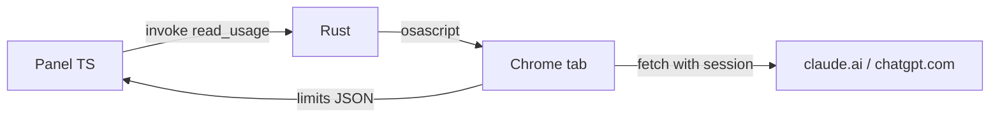

# AI Usage

macOS menu bar app showing Codex Plus and Claude Pro usage: 5-hour and weekly limits with reset times.

Limits are read inside logged-in Google Chrome tabs via Apple Events. Cookies and tokens never leave Chrome; the app receives only percentages and reset times.



## Requirements

- Node.js and npm
- Rust: `curl --proto '=https' --tlsv1.2 -sSf https://sh.rustup.rs | sh`
- Xcode Command Line Tools: `xcode-select --install`

## Commands

```bash
npm install
npm run tauri dev    # run from source
npm test             # unit tests
npm run tauri build  # bundle .app
```

Install the built app:

```bash
cp -R "src-tauri/target/release/bundle/macos/AI Usage.app" /Applications/
```

## One-time setup

1. Log in to `claude.ai` and `chatgpt.com` in Chrome.
2. Chrome: **View → Developer → Allow JavaScript from Apple Events**.
3. First refresh: allow AI Usage to control Google Chrome. Revoke or restore in **System Settings → Privacy & Security → Automation**.

In-app instructions: `help.html`.

## Where things live

| Path | Role |
|---|---|
| `src-tauri/scripts/read-usage.applescript` | Finds or opens the tab, runs the page script, polls the result |
| `src-tauri/scripts/claude.js`, `codex.js` | Endpoints per provider; output format parsed in `src/reader.ts` |
| `src-tauri/scripts/runner.js`, `poll.js` | Shared page wrapper; the `window.__aiUsageReader` key must match in both |
| `src-tauri/src/usage_reader.rs` | Runs `osascript` with the bundled scripts only |
| `src/reader.ts` | Parses script output, maps errors to messages |
| `src/panel.ts`, `src/main.ts` | Panel rendering and refresh flow |

Endpoints are undocumented. When a provider changes its response, update its page script and the parser tests in `src/reader.test.ts`.
