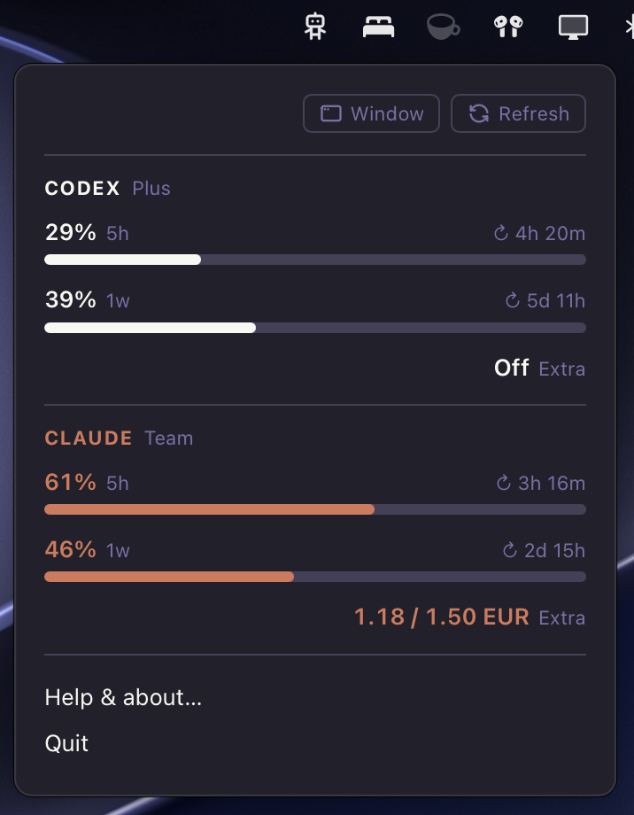
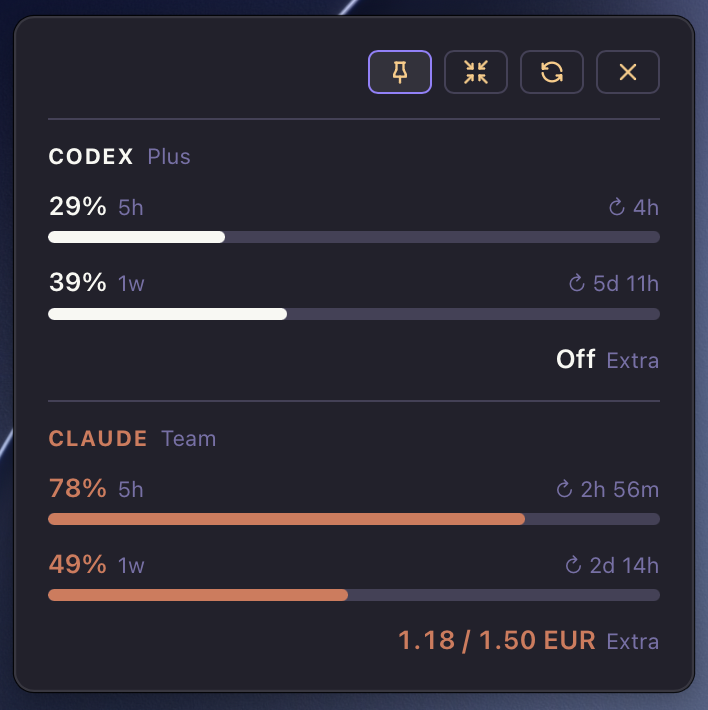
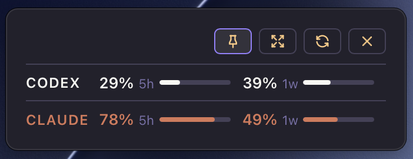

# ai-usage

A macOS menu bar app that shows your Codex and Claude subscription usage (5-hour, weekly and extra), refreshed every minute.

<table>
  <tr>
    <td align="center"></td>
    <td align="center"></td>
    <td align="center"></td>
  </tr>
  <tr>
    <td align="center">Menu bar panel</td>
    <td align="center">Standalone window, pinned on top</td>
    <td align="center">Compact window</td>
  </tr>
</table>

## About

The app signs in to `chatgpt.com` and `claude.ai` in its own hidden windows and reads their usage endpoints from inside those pages. Session tokens never leave the page.

## Installation

Prebuilt app on the [Releases](https://github.com/twistezo/ai-usage/releases) page, for Apple Silicon Macs only. Unzip it and move `AI Usage.app` to `/Applications`.

The app is not notarized, so macOS blocks the first launch. Open it once, then go to **System Settings → Privacy & Security** and click **Open Anyway**, or run:

```bash
xattr -dr com.apple.quarantine "/Applications/AI Usage.app"
```

### First run

Click the robot icon, choose “Log in to Claude” or “Log in to ChatGPT”, sign in with the **code from the e-mail** (the link would open in your browser instead) and close the window.

## Requirements

- macOS
- Node.js
- npm
- Rust
- Xcode Command Line Tools

## Usage

### Development

```bash
npm install
npm run tauri dev
```

The development build keeps its own logins, separate from the installed app.

### Tests

```bash
npm test
cargo test --manifest-path src-tauri/Cargo.toml
```

### Production

```bash
npm run tauri build
rm -rf "/Applications/AI Usage.app"
cp -R "src-tauri/target/release/bundle/macos/AI Usage.app" /Applications/
```
