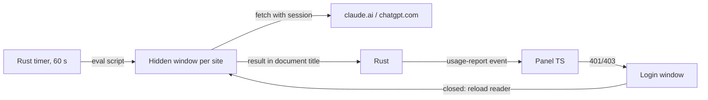

# AI Usage

macOS menu bar app showing Codex Plus and Claude Pro usage: 5-hour and weekly limits with reset times, refreshed every minute in the background.

The app keeps its own Claude and ChatGPT sessions. Hidden windows load each site and fetch the usage endpoints with that session; only percentages and reset times reach the panel.



The result travels through the document title so the remote pages never get access to the app's IPC.

## Requirements

- Node.js and npm
- Rust: `curl --proto '=https' --tlsv1.2 -sSf https://sh.rustup.rs | sh`
- Xcode Command Line Tools: `xcode-select --install`

## Commands

```bash
npm install
npm run tauri dev    # run from source
npm test             # unit tests
npm run tauri build  # bundle .app
```

Install the built app:

```bash
cp -R "src-tauri/target/release/bundle/macos/AI Usage.app" /Applications/
```

## First run

Click the menu bar icon, then “Log in to Claude” / “Log in to ChatGPT”. Log in with the e-mail code, not the link: the link opens in the default browser. Close the login window; readings start within seconds.

Sessions live in the app's WebKit store (`~/Library/WebKit/ai-usage` in dev, `~/Library/WebKit/com.twistezo.ai-usage` for the bundle).

## Where things live

| Path | Role |
|---|---|
| `src-tauri/src/session_reader.rs` | Hidden reader windows, login windows, 60 s timer, hourly page reload |
| `src-tauri/scripts/claude.js`, `codex.js` | Endpoints per provider |
| `src-tauri/scripts/report.js` | Shared wrapper; its title prefix must match `TITLE_PREFIX` in `session_reader.rs` |
| `src/reader.ts` | Parses reports, maps errors to messages and login prompts |
| `src/panel.ts`, `src/main.ts` | Panel rendering and refresh flow; `REPORT_EVENT` and `AUTO_REFRESH_NOTE` must match `session_reader.rs` |
| `src/styles.css` | Dracula Pro (dark) and Alucard (light) palettes, brand colors `--brand-codex`, `--brand-claude` |

Endpoints are undocumented. When a provider changes its response, update its page script and the parser tests in `src/reader.test.ts`.
